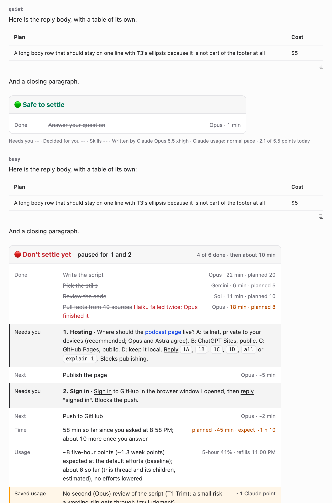
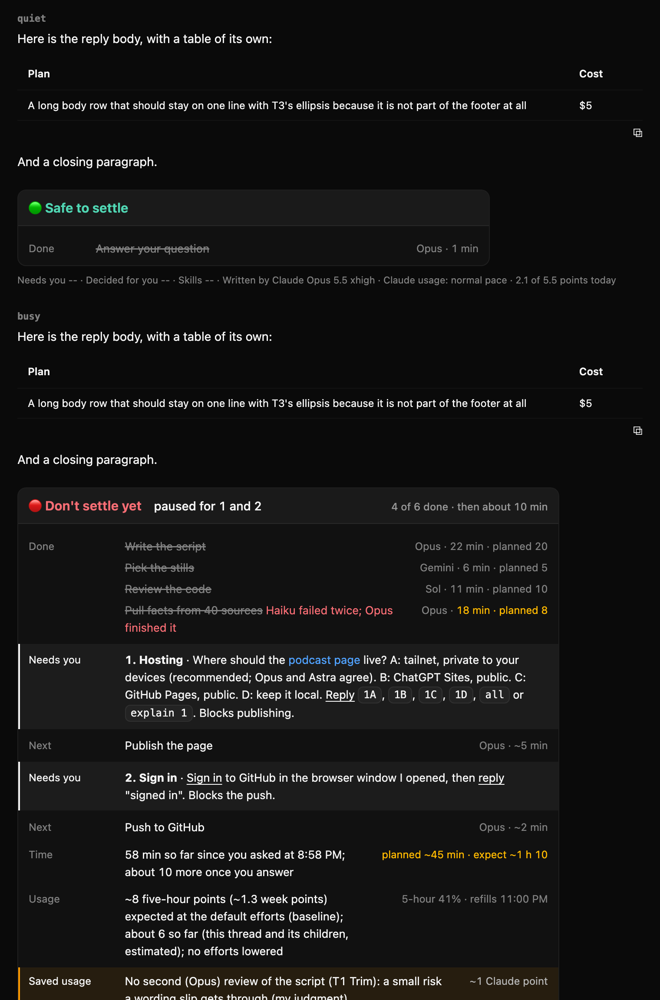

# T3 reply footer

A status card at the end of every AI agent reply in [T3 Code](https://github.com/pingdotgg/t3code). The agent writes it as plain Markdown, and a small stylesheet in T3 draws it as a card. It shows:

- **Verdict:** whether the thread can be settled (🟢 Safe to settle / 🔴 Don't settle yet), with a short reason and progress.
- **The plan:** finished steps crossed out, running steps highlighted in the theme's accent, then what's next.
- **Needs you:** numbered questions and actions the human has to handle, each placed right above the step it blocks.
- **Honest time:** time spent so far against the estimate made before the work started, with overruns flagged.
- **Usage:** the expected cost against a baseline, plus anything that was trimmed to save usage and what that likely cost in quality.
- **Team:** which models did what, at which effort level.



<details><summary>Dark theme</summary>



</details>

## What's here

| File | What it is |
|---|---|
| [`RULES.md`](RULES.md) | The instructions agents follow to write the footer. Paste it into `CLAUDE.md`, `AGENTS.md` or `GEMINI.md`. |
| [`footer.css`](footer.css) | Draws the card in T3. It uses the active theme's colours (`--info`, `--destructive`, `--success`), so it works in every theme. |
| [`test/`](test) | Runs the examples from `RULES.md` through T3's Markdown pipeline and T3's own CSS, then checks the card in headless Chrome: light and dark, desktop and phone widths, no stylesheet, and each team-list mode. |
| [`docs/`](docs) | Design decisions, the project history and screenshots. |

## How it works

The agent ends each reply with `---`, then a three-column Markdown table (status · step · who and when). The table's header holds the verdict, wrapped in `<span itemprop="settle-yes">` or `settle-no`. After that come an optional `<details>` team list and one small `<sub>` line.

T3's sanitizer keeps `itemprop`, `<ins>`, `<del>`, `<sub>` and `<details>`, so these act as styling hooks without any scripts. The CSS only touches the table right after a reply's last `<hr>`, and only when that table has the verdict hook and three columns. Every other table keeps T3's normal look.

Without the stylesheet, the footer is still a readable Markdown table (see `docs/screenshots/footer-test-light-nocss-360.png`).

Hooks: `itemprop` = `settle-yes` · `settle-no` · `running` · `failed` · `over` · `saved`; `<ins>` marks words the human acts on; `~~…~~` marks finished steps and answered items.

## Install

1. Add `RULES.md` to your agent instructions file (for example `~/.claude/CLAUDE.md`). Before you do, change the model names, usage tools (`claude-tier`, `lab-usage`) and the person's name to your own setup.
2. Load `footer.css` into T3 Code. T3 has no built-in user stylesheet yet. The author injects it with a small local add-on loader; any way of adding a `<style>` to T3's window works.

The team-list switch is optional: set `data-t3x-footer-team` on `<html>` to `always-show`, `start-folded` or `always-hide`. With nothing set, it starts open.

## Test

```sh
npm ci --prefix test
test/run.sh            # 9 views; exit 1 if any check fails
SHOTS=1 test/run.sh    # also saves screenshots to docs/screenshots/
```

It needs Node 20+ and Chrome. Set `CHROME=/path/to/chrome` if it isn't found.

`test/t3-subset.css` is part of T3 Code's compiled stylesheet, included so the test pages look like T3. It is under T3 Code's MIT licence (see `test/third-party/T3-CODE-LICENSE`).

## Status

- [x] Footer rules (round 11, with Time, Usage and Saved usage rows)
- [x] Card CSS, approved and installed in T3 Code Nightly
- [x] Test harness, 9 views passing
- [x] Phone layout (who-and-when drops under the step)
- [ ] A native user-stylesheet hook in T3, so no loader is needed

## License

MIT, except `test/t3-subset.css`, which is T3 Code's MIT-licensed CSS (see `test/third-party/T3-CODE-LICENSE`).
